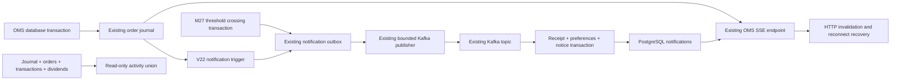

# M41?M43: event-driven simulated portfolio experience

## Architecture and audit

The existing M25/M26 notification system already supplies PostgreSQL notifications, a UUID-keyed transactional notification_outbox, Kafka topic `portfoliolab.notifications.v1`, a batch publisher, and read APIs. M27 price alerts atomically change alert status and enqueue PRICE_ALERT through PortfolioEventOutbox. OMS M31?M37 uses PostgreSQL orders, fills, execution receipts, transactions, and the V20 simulated_order_events trigger journal. Its existing SSE endpoint reads committed journal rows and emits reset on every connection. M38?M40 research and reconciliation remain unchanged.

M41 extends these components; there is no second event bus or alert engine. All money, trading and events remain fictional simulations.



## Migration

`V22__notification_experience.sql` adds notification_preferences, permanent notification_receipts, an unread index, and an AFTER INSERT trigger on the existing OMS event journal. Only future FILLED, PARTIALLY_FILLED, CANCELLED and EXPIRED journal entries enqueue notifications. No historical lifecycle is fabricated or backfilled. Existing notifications seed receipts so replay remains idempotent after retention. The trigger uses a deterministic UUID derived from the journal ID and writes into the existing outbox inside the financial transaction. Rolling back the order also rolls back journal and outbox writes. Flyway applies the migration normally; do not edit old migrations or repair checksums.

## Reliability, preferences and idempotency

The publisher reads at most 25 pending events and marks published only after Kafka acknowledges. Failure leaves rows pending and stops that batch. An acknowledgement followed by a crash before the update can produce another delivery; a unique receipt prevents another notice. Receipt insertion, preference evaluation and notification insertion share the consumer database transaction. A failed transaction rolls back the receipt too. Disabled events still get receipts, so re-enabling a preference does not resurrect old suppressed events. Preferences are evaluated at processing time, including events delayed by an outage.

Kafka uses record acknowledgements, a 25-record poll limit, producer idempotence, bounded producer timeouts, and five-second consumer retry backoff without discarding exhausted retries. A malformed record can block its partition and needs operator correction; it is not silently dropped. Kafka retains its existing broker/topic retention configuration; an outage longer than broker retention still requires operational recovery.

Each actual partial fill may produce one status notice; replay never produces another. TRADE_EXECUTED events backed by an OMS execution receipt are suppressed because the same fill has an order notice. Legacy synchronous trades retain their notices. No automated trading or external delivery is introduced.

The SSE endpoint now also sends portfolio-scoped `notification` invalidation hints after committed notices appear. Order event IDs keep their existing meaning; notification hints do not overwrite the order Last-Event-ID cursor. Every initial connection and reconnect emits reset; the browser reloads persisted notification history and the exact unread count via HTTP. This recovers missed hints and browser restarts without browser polling. Notification bursts coalesce over 100 ms, and cleanup closes the stream. Existing OMS SSE and fallback behavior is preserved. SSE is advisory; HTTP and PostgreSQL are authoritative.

Hourly retention removes at most 1,000 notices older than 90 days and 1,000 acknowledged outbox rows older than 90 days. Unpublished outbox rows are never aged out. UUID receipts remain permanently to prevent resurrection on arbitrarily old replay. Journal and financial history are not pruned by this feature.

## API contracts

Backend paths are rooted at `/api/portfolios/{portfolioId}`. Next proxies always select demo portfolio 1; caller query/body portfolio IDs cannot select another portfolio. Existing backend ownership remains the local single-user demo model, not authenticated multi-tenant access.

| Method and path | Contract |
| --- | --- |
| GET `/notifications?before=<id>&limit=50` | Existing array of `{id,source,title,message,targetUrl,createdAt,read}`; newest ID first, exclusive cursor, limit clamped 1?100. Omit before for first page. |
| GET `/notifications/unread-count` | `{count}` over all retained unread notices. |
| PATCH `/notifications/{id}/read` | Set read; scoped ID, 404 for another portfolio. |
| PATCH `/notifications/{id}/unread` | Clear read; same scope checks. |
| GET `/notifications/preferences` | Event type to boolean map; absent values default true. |
| PUT `/notifications/preferences` | Partial map update; unknown keys/null values return 400. |
| GET `/activity?type=ALL&limit=50` | Array `{key,occurred_at,type,order_id,transaction_id,description}`. |
| GET `/activity?beforeTime=<ISO offset timestamp>&beforeKey=<key>&type=...` | Exclusive composite cursor from the previous page's final entry; preserves PostgreSQL timestamp precision. Limit clamped 1?100. |
| GET `/simulated-orders/events` | Existing order/reset SSE plus notification hints; demo portfolio boundary and 100-client cap retained. |

Preference keys: ORDER_FILLED, ORDER_PARTIALLY_FILLED, ORDER_CANCELLED, ORDER_EXPIRED, PRICE_ALERT, TRADE_EXECUTED, DIVIDEND_CREDITED, AGENT_INSIGHT. These deterministic event switches provide compact category/status controls. Optional custom rules were omitted; existing M27 crossing rules remain the only price-rule engine.

Activity types: ALL, SUBMITTED, ACCEPTED, PARTIALLY_FILLED, FILLED, CANCELLED, EXPIRED, REJECTED, SETTLED, DIVIDEND, LEGACY_ORDER. ALL includes persisted journal statuses. Ordering is `(occurred_at DESC,key DESC)` with a unique source-qualified key. Timeline settlements come from transactions joined to actual execution receipts. Dividends come from persisted payments. Orders predating the journal get an explicitly labeled current-status summary at their recorded creation time, without invented transition dates. The view stores no duplicate financial records. Order links open existing exact-ID details; transaction links lead to the retained transaction-history section.

## Frontend integration

Existing navigation already had Activity and Notifications. Activity now places the unified timeline above the existing Transaction History. Notifications adds a compact preference disclosure, loaded-history pagination, and read/unread actions. The pre-existing `read` versus `readAt` frontend mismatch is corrected. The bell shows the authoritative global unread count; the center labels its count as loaded history. Mark-loaded-as-read only affects fetched rows. SSE resets and hints replace both 15-second browser polling loops. No new dependencies.

## Verification results

Verified on 16 October 2026:

| Check | Actual result |
| --- | --- |
| Full backend Maven suite, PostgreSQL integration included | **108 passed, 0 failures, 0 errors, 0 skipped**; BUILD SUCCESS. |
| Existing frontend M34 suite | **27 passed**. |
| Existing frontend M35?M37 suite | **9 passed**. |
| Existing frontend M38?M40 suite | **5 passed**. |
| New frontend M41?M43 suite | **4 passed**. |
| TypeScript `npx tsc --noEmit` | Passed. |
| Focused ESLint on notification center/bell/preferences, activity timeline and update helper | Passed, exit 0. |
| Production `npm run build` | Passed; routes generated successfully. |
| `git diff --check` | Passed (Git reports normal Windows line-ending notices). |

The final backend command used UTC, a three-connection pool per context and a one-context cache (see below); total Maven time was 2 minutes 31 seconds. Earlier attempts exposed this host's unsupported Asia/Calcutta PostgreSQL timezone alias and one transient closed-connection error before reconciliation could acquire a transaction. An initial preference-validation bug found by integration testing was fixed before the final passing run. The pool/cache options apply only to verification, not production configuration.

Focused backend checks exercise the real PostgreSQL migration/trigger, consumer entry point replay, suppression replay after preferences change, replay after notice deletion, read/unread and cross-portfolio mutation rejection, real M27 crossing exactly once, transactional rollback of journal/outbox, and composite activity pagination with tied timestamps. Publisher unit tests verify that a failed Kafka send leaves the batch pending and only an acknowledged send marks publication. SSE tests verify scoped notification hints, initial/reconnect reset, existing order cursor replay and portfolio rejection. Existing OMS integration and SQL reconciliation tests pass.

Consumer idempotency is tested against PostgreSQL through the actual listener method; publisher failure uses a controlled Kafka mock. A live broker stop/restart fault injection and interactive browser walkthrough were **not** performed. Frontend stream tests use an EventSource test double to verify reconnect reset, burst coalescing, wrong-portfolio rejection and cleanup. The production build supplies compilation/routing verification, not a browser interaction test.

## PowerShell verification

```powershell
Set-Location C:\Users\hello\Projects\PortfolioLab\backend
# PostgreSQL and the existing Kafka stack must be running.
# UTC avoids PostgreSQL rejecting this Windows host's Asia/Calcutta JVM alias.
.\mvnw.cmd test '-DargLine=-Duser.timezone=UTC' '-Dspring.datasource.hikari.maximum-pool-size=3' '-Dspring.test.context.cache.maxSize=1' '-Dlogging.level.root=WARN' '-Dlogging.level.org.springframework=WARN'
Set-Location ..\frontend
npm run test:m34
npm run test:m35-m37
npm run test:m38-m40
npm run test:m41-m43
npx tsc --noEmit
npm run build

Invoke-RestMethod 'http://localhost:8080/api/portfolios/1/notifications?limit=10'
Invoke-RestMethod 'http://localhost:8080/api/portfolios/1/notifications/unread-count'
Invoke-RestMethod 'http://localhost:8080/api/portfolios/1/activity?type=SETTLED&limit=10'
Invoke-RestMethod 'http://localhost:8080/api/portfolios/1/notifications/preferences'
# In a separate terminal; reset appears on every connection:
curl.exe -N 'http://localhost:3000/api/portfolio/simulated-orders/events'
```

For manual outage verification, stop Kafka using the repository's existing local stack workflow, create/cancel a simulated order, and confirm the order succeeds with an unpublished outbox row. Restart Kafka: one notice should arrive. Disconnect/reconnect the browser stream and confirm history/count recover from HTTP. Settings affect processing, not historical notices. These manual browser/broker exercises are distinct from automated consumer, publisher and reconnect tests.

## Limitations

- Local single-user ownership model is unchanged. Deploying for multiple users requires authentication/authorization across the existing application, including these APIs.
- SSE is the existing single-process, database-backed dispatcher; it is not a distributed push service. Other tabs recover read-state changes on reconnect or refresh; new notices invalidate immediately.
- No custom rule language, delivery channels, historical event reconstruction, or account events without persisted evidence.
- Receipt metadata grows with processed event count. Bounded retention intentionally does not erase deduplication evidence.
- Timeline is an internal simulated record view, not an external broker statement. Existing synchronous settlements occur at transaction creation; no independent clearing cycle is invented.

## Files changed

Backend: V22 migration; NotificationController, NotificationEventConsumer, NotificationKafkaConfig, OrderEventStream; new ActivityController, NotificationPreferences, NotificationRetention; NotificationExperienceIntegrationTests, NotificationDeliveryTests and OrderEventStreamTests.

Frontend: Activity/Notifications pages; existing NotificationCenter, NotificationBell, RecentOrders, ActivityHistory; new ActivityTimeline, NotificationPreferences, notification-updates helper; scoped activity/preferences/unread proxies and notification pagination proxy; m41-m43 tests and package script. This document records the implementation and verification.

Recommended commit message: `feat: integrate persistent notifications, activity timeline and event preferences (M41-M43)`

No commit or push was performed.
