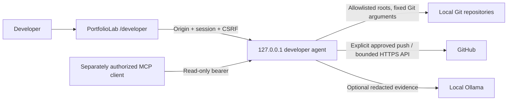

# M47–M49: Developer Studio

Developer Studio is PortfolioLab's local developer workspace at **`/developer`**. It provides real repository inspection, exact diffs, file staging, reviewed commits and non-force pushes, and a GitHub Actions command center. Financial services, the database, Kafka, and the existing brokerage AI tools are unchanged.

## Architecture and audit

The frontend is the existing Next.js 16.4 / React 19 app and uses AppShell's theme, navigation, and CSS variables. `services/developer-agent` is an isolated Node 24.12+ TypeScript service using native HTTP, filesystem, crypto, and argument-based `execFile`. There are no agent runtime npm dependencies, database, broker, or paid services. The frontend adds highlight.js for safe syntax highlighting; the original diff text is retained separately.

The existing sibling `portfoliolab-ai` service was inspected: it uses Ollama `qwen2.5:0.5b`, HTTP port 3101, and separate MCP server/client modules. Its brokerage tools do not have a trustworthy developer authorization boundary. Developer tools therefore remain isolated; the brokerage Ask AI gains no Git capability. Studio reuses the bounded local Ollama pattern, with its own read-only tool dispatcher and MCP endpoint. No changes were made to the sibling repository.



## PowerShell setup

Prerequisites: Node **24.12 or newer**, Git for Windows (including its bundled shell), and an existing Git author name/email. There are no agent npm dependencies. Do not run as Administrator.

Start the existing frontend first, in one terminal:

```powershell
Set-Location C:\Users\hello\Projects\PortfolioLab\frontend
npm ci  # First setup or after dependency changes
npm run dev
```

In a second terminal, launch Developer Studio:

```powershell
Set-Location C:\Users\hello\Projects\PortfolioLab
.\scripts\start-developer-studio.ps1
```

**No read or write passphrases are requested.** The launcher starts the loopback agent, waits for readiness, and opens the default browser directly at Developer Studio using a fresh one-time bootstrap. The connection expires after two minutes if unused. Keep the launcher terminal open. If the frontend was not ready when the browser opened, start it and enter **R** in the launcher to open a new connection.

The launcher offers:

| Key | Action |
| --- | --- |
| R | Revoke the old session/reviews/PAT, generate a fresh bootstrap, and reopen Studio |
| G | Enter your fine-grained GitHub PAT once using a hidden terminal prompt; no restart needed |
| Q | Stop the agent and discard sessions/credentials |

GitHub is optional: local inspection, staging, and commits work without a PAT. To connect later, choose **Connect GitHub** in Studio for instructions, enter **G** in the launcher terminal, and paste the PAT into the hidden prompt. Returning focus to the browser refreshes connection status; **Refresh connection** does the same. The browser never accepts or receives the PAT.

The previous launch command still works and requests only the optional PAT:

```powershell
.\scripts\start-developer-studio.ps1 -GitHubCredential

# Optional explicitly allowlisted sibling repository / already installed local model:
.\scripts\start-developer-studio.ps1 -IncludeAiRepository -OllamaModel 'qwen2.5:0.5b'
```

No model is downloaded. If you connect GitHub before consuming the bootstrap, its PAT is pending only until that bootstrap is used or expires. A browser reload restores an existing unexpired cookie session without another connection link or PAT. At 30-minute session expiry, or after Disconnect/reconnect/agent shutdown, enter R and reconnect; supply a PAT again only if needed for the new session.

Startup checks report missing/old Node, missing Git, missing frontend dependencies, invalid origins/ports, unavailable repositories and occupied agent ports. A browser-association failure reports how to retry; bootstrap links and credentials are never printed. Follow the machine's existing PowerShell execution policy.

Agent port defaults to 4317, frontend origin to http://localhost:3000, and frontend agent URL to http://localhost:4317. For a custom port use `-Port` and set `NEXT_PUBLIC_STUDIO_AGENT_URL` in the frontend's ignored .env.local, then restart Next.js. For `-FrontendOrigin http://127.0.0.1:3000`, also use 127.0.0.1 in the frontend agent URL: Strict cookies require matching hostnames. No hosted origin is permitted. Never place a PAT or bootstrap credential in NEXT_PUBLIC variables.

### Explicit repository configuration

The launcher derives/canonicalizes the main Git root from its own location. The sibling portfoliolab-ai root is included only with `-IncludeAiRepository`. Browser requests use allowlisted IDs, never filesystem paths. The agent rejects missing/non-root paths and external Git directories/linked worktrees.

The launcher communicates initial configuration and reconnect/GitHub commands through the child process's private stdin pipe. Bootstrap and PAT values are absent from environment variables, command arguments and files. There is no HTTP endpoint that mints bootstraps or accepts a PAT. Direct `npm start` is not the interactive launcher; use the PowerShell command above. Advanced code embedding can call `createAgent` with a random bootstrap and explicit repository configuration. Optional STUDIO_MCP_SECRET remains a separate read-only non-browser credential; it never authenticates the developer UI.

## Authentication and authorization

The launcher generates **32 cryptographically random bytes** for each connection using the OS cryptographic RNG. It passes the credential privately to the agent and opens `/developer#bootstrap=...`. This is a **two-minute, single-use bootstrap**, not a permanent application credential. URL fragments are not sent in HTTP requests/referrers. On mount the frontend removes the fragment with history.replaceState **before** its POST exchange; it does not persist the credential in localStorage/sessionStorage. Replays, expired/malformed/unknown credentials, and cross-origin attempts are rejected. The agent stores only a bootstrap hash, and consumes it synchronously before creating a session. Failed exchanges are throttled (ten per minute).

The agent binds only to **127.0.0.1** and validates Host plus the exact configured local frontend Origin before parsing authentication requests. All browser requests are bounded JSON POSTs. A successful bootstrap creates a random **HttpOnly, SameSite=Strict, path-limited session cookie**, an independent in-memory CSRF token, and an absolute **30-minute expiry**. The cookie/CSRF never authorizes an unallowlisted repository. Expired sessions clear server-side PATs and approvals, including timer-based cleanup; queue execution rechecks that the session remains valid.

`POST /studio/session` restores the browser's in-memory CSRF/status from an existing HttpOnly cookie after reload. This read-only route is the only authenticated CSRF exemption: it still requires the exact Origin and JSON POST, and cannot stage, prepare a write, or extend expiry. Every other authenticated application endpoint enforces CSRF. A local-session error has code SESSION_REQUIRED so a GitHub 401 does not accidentally disconnect the developer session. The UI shows connection/expiry, clears private views on expiry, and directs users to R in the launcher if the cookie cannot be restored.

There is **one developer session and no secondary write password**. Session authorization permits access to write endpoints, while **each staging/unstaging/commit/push still requires explicit approval**. Commit/push additionally require session-owned, expiring, single-use reviews and the unchanged staged-tree / remote snapshot checks. MCP cannot authorize itself or register an application write approval. No brokerage account or frontend role flag grants these privileges.

The bootstrap is not advertised by an unauthenticated HTTP endpoint. Arbitrary websites cannot read it or pass the Origin boundary; ordinary local processes cannot obtain a session merely by spoofing Origin without also possessing the unpredictable bootstrap or cookie/CSRF. The trusted boundary is the local OS account and authorized frontend: malware with access to browser memory, debugger privileges, or the launcher's private pipes is outside the threat model. Browser extensions/history systems may briefly observe a bootstrap URL before cleanup, so never share it; it expires quickly and can be used only once. Local HTTP uses no Secure cookie attribute; do not expose this service through a tunnel, reverse proxy, LAN bind or hosted app. No OAuth, database, permanent shared credential or hosted authentication was introduced.


## How to review, commit, and push PortfolioLab changes using Developer Studio

1. Open the launcher-created `/developer` connection and select an authorized repository.
2. Refresh local state. Branch, HEAD, origin, upstream and counts are local observations. Ahead/behind uses existing local tracking refs; no automatic fetch is implied. Line counts show tracked net changes against HEAD and exclude binaries and untracked content.
3. In **Explore**, search/filter by path, status, staging, subsystem, or extension. Directory groups always include every changed file. Open a file to inspect plain-English status, technical staging context, review flags, and the exact diff. Switch between staged and worktree layers for partially staged files. Edit a file's review group if helpful; overrides last for the current selected repository/session. Optional AI grouping suggestions are advisory and never select files automatically.
4. Select the exact files to stage. Check the index-change approval and choose Stage selected files. “Select visible” supports reviewing a whole filtered group. Untracked files are included. No hidden `git add -A` occurs. Unstage preserves working files.
5. Open **Commit** and prepare a fresh review. Read the staged file list, flags, tree/snapshot identifier and exact full staged diff. Edit the suggested conventional title/body. Approve this content and message, then create the commit. Studio returns the SHA and preserves unstaged edits.
6. Open **Push** and prepare the outgoing review. The destination defaults to origin's upstream branch when present, otherwise the local branch. You may type an explicit destination branch. Review the HTTPS remote, destination, outgoing commits, and live divergence. Approve and push separately.
7. After Git confirms success, **CI** queries GitHub Actions for that exact pushed SHA. If no run has started, it says so. Refresh manually, inspect jobs/steps, and follow source links for full logs. A successful push never becomes an assumed green CI result.
8. Disconnect the session when finished (or enter Q in the launcher). Everyday review/stage/commit/push/CI work is available through these controls.

## Git correctness and boundaries

- Every Git call uses a fixed executable and argument arrays; frontend-supplied command names/flags and arbitrary shells are unsupported. Paths are literal Git pathspecs. Traversal, Git-internal paths, symlinks and junctions are rejected for file operations. Canonical repository identity is rechecked. Repositories and their `.git` configuration/object stores must belong to the trusted local developer; this is not a sandbox for hostile Git installations or malicious local OS processes.
- Status uses NUL-delimited porcelain, including rename sources, conflict states, and untracked files. Tracked diffs use `git diff --no-ext-diff --no-textconv`; untracked text uses real `git diff --no-index /dev/null <path>`, preserving Git's newline markers. Binary files have an explicit indicator. Initial preview limit is 128 KiB; explicit expansion is bounded to 2 MiB, with truncation clearly indicated. Git output is capped at 4 MiB. Staged review above 2 MiB is rejected rather than silently omitted.
- Staging is **whole file only**. It can replace an existing partial selection for a selected file. Hunk staging, conflict resolution, submodule editing and split diff view are not implemented. Unified diffs have line numbers, safe syntax highlighting, expandable sections and a UI rendering limit with an explicit expansion button.
- Commit review fingerprints the Git tree, parent HEAD and full branch ref with SHA-256. It rechecks tree/HEAD/ref during preparation. Execution atomically acquires `index.lock`, copies the index to a private temporary index, derives its tree, checks the approved fingerprint, creates a commit with `commit-tree`, and updates the branch using `update-ref` with the expected parent. Temporary index/locks are removed in `finally`. Normal Git clients respect the index lock. A raw filesystem writer that ignores Git's locking is outside this coordination guarantee.
- Commits are **unsigned and do not run hooks**. GPG signing, hooks, fsmonitor, diff executables/textconv, automatic maintenance and configured clean/smudge/process filters are disabled or rejected where relevant. Required signing/hook policies must use the developer's Git client. No amend, history rewrite, automatic merge, rebase, reset, cleanup or deployment is offered. Detached HEAD, unresolved conflicts, merge-in-progress, empty index and stale reviews are rejected.
- Push preparation contacts origin via validated credential-free **GitHub HTTPS only**, checks remote refs and fetches the destination's objects for divergence. This updates FETCH_HEAD/object storage but not local branches or working files. It rejects transport URL rewrites and repository transport overrides. Protection state is explicitly “unknown”; GitHub enforces it on push. Missing upstream is supported by an explicit destination; Studio does not implicitly change upstream configuration.
- Push re-prepares the exact destination and compares the approved snapshot. It sends the reviewed **SHA**, not a moving branch ref, with an ordinary non-force refspec. Remote races remain subject to Git's normal non-fast-forward checks. Divergence, zero outgoing commits, stale reviews, and Git failures are reported; there is no automatic destructive recovery. Up to 30 outgoing commit titles are displayed with an explicit limit.

## GitHub credentials and CI

Use your own expiring **fine-grained PAT**, limited to the necessary repositories. For pushes request Contents read/write; for Actions inspection request Actions read; GitHub supplies Metadata read. Editing workflow files may additionally require Workflows write; grant it only when needed. Organization authorization and branch protections still apply. Do not use classic PATs, shared tokens, broad account permissions, or token-bearing remotes. A fine-grained PAT does not automatically refresh.

The launcher accepts the PAT through hidden terminal input and passes it to the agent over private stdin. The PAT is held only in the current local session's GitHub client; reconnect, logout, expiry and shutdown clear it along with approvals. Updating an expired PAT only requires G in the launcher, not a restart. Fine-grained PATs still require appropriate repository selection, expiration, permissions and any organization approval; the agent does not claim to verify all token restrictions in advance.

The value is absent from frontend code, API responses, browser storage, configuration files, Git URLs, ordinary Git subprocess environments and command arguments. For an approved Git HTTPS operation only, the credential goes through a child environment to the fixed askpass helper; credential helpers are cleared and redirects disabled. The helper only answers GitHub username/password prompts. Separately authenticated MCP bearer clients do **not** inherit the UI session's GitHub token; public CI remains accessible. This is **session-only credential mode**, not OS-backed persistent storage. OS account/process-memory security remains required.


GitHub API requests use HTTPS, fixed `api.github.com` endpoints, no redirects, timeouts, 1 MiB response limits, and bounded pages (15 workflow runs, 30 jobs). Read-only public CI works without a PAT. Responses distinguish status from conclusion, retain unknown/cancelled/skipped/timed-out states, and expose original GitHub links. Jobs/steps include timestamps and computed durations. Run `updated_at` is labeled last updated, not falsely claimed as completion time. No polling or cache freshness assumptions are used. Authentication/permission errors, unavailable resources, rate limits and network errors have separate handling.

**Restricted M49 scope:** full logs and annotations are accessible through GitHub source links rather than downloaded inside Studio. Failure summaries use actual job/step names and conclusions. Optional AI receives that metadata and must state that root cause is unknown without logs. There is no claimed log-grounded diagnosis, no workflow creation, no workflow rerun, and no deployment trigger.

API references: [GitHub Actions workflow runs](https://docs.github.com/en/rest/actions/workflow-runs), [workflow jobs](https://docs.github.com/en/rest/actions/workflow-jobs).

## API contracts

Base: `http://localhost:4317/studio`. Requests are POST JSON with `Content-Type: application/json`, exact frontend `Origin`, and, after bootstrap, session cookie plus `X-Studio-CSRF`. No GET endpoints or ordinary brokerage authorization tokens are accepted. Responses are JSON with `Cache-Control: no-store`; errors use `{ "error": "actionable message" }`.

| Endpoint | Input (in addition to `repo` ID) | Result |
| --- | --- | --- |
| `bootstrap` | launcher-generated one-time `credential` (no repo needed) | Session cookie, CSRF, expiration, GitHub-connected boolean |
| `session` | none (cookie + exact Origin; read-only CSRF exemption) | Restored CSRF, absolute expiration, GitHub-connected boolean |
| `logout` | none | Session invalidation |
| `repos` | none | Authorized IDs/names and credential/AI availability |
| `status` | none | Branch, HEAD, origin, upstream, files, counts, recent commits, observation time |
| `diff` | `path`, `layer: staged\|unstaged`, optional `expanded` | Exact text, binary/truncated flags, review flags |
| `stage`, `unstage` | `paths: string[]`, `approve: true` | Updated repository state |
| `prepare-commit` | none | Snapshot, tree, HEAD/ref, paths, exact diff, flags, suggestion |
| `commit` | `snapshot`, `title`, optional `body`, `approve: true` | SHA/title |
| `prepare-push` | optional `destination` | Snapshot, SHA, remote/destination, outgoing commits, divergence |
| `push` | `snapshot`, `approve: true` | Git-confirmed SHA/destination |
| `ci` | optional exact `sha` | Bounded workflow runs and fetch time |
| `ci-details` | numeric `runId` | Jobs, steps, deterministic failures, fetch time |
| `analyze` | `scope`, relevant `path/layer/hunk/runId` | Explanation, evidence, source, limitations |
| `mcp` | MCP JSON-RPC 2.0 envelope | Read-only MCP result |

Requests are capped at 32 KiB; file selection at 500 paths; title at 120 characters; body at 10,000 characters. Git operations have 60-second timeouts; GitHub requests 15 seconds. Per-repository queues serialize application work. Unknown IDs/actions, malformed JSON, stale/expired approvals, unauthorized requests, and unsupported paths fail closed. Git failures may return a bounded redacted diagnostic; unexpected server exceptions return a generic error without filesystem or credential details.

## MCP tool contracts and AI

The isolated `/studio/mcp` implements JSON-RPC initialization (`2025-03-26`), initialized notification, ping, tools/list and tools/call over stateless HTTP POST with JSON responses. It exposes no resources/prompts/subscriptions. Authenticate with the existing application session/CSRF, or configure a distinct `STUDIO_MCP_SECRET` (32+ characters) and use `Authorization: Bearer <secret>` from a non-browser client. Bearer requests with an Origin header are rejected. This bearer is read-only and never grants application write permission. Keep it out of brokerage MCP configuration.

Every tool accepts `repo` (allowlisted ID); optional fields are documented in the published input schemas:

| Tool | Additional input | Evidence |
| --- | --- | --- |
| `get_repository_status`, `get_branch_status` | none | Local repository overview |
| `list_changed_files` | none | Actual changed files and flags |
| `get_file_diff` | `path`, optional `layer` | Up to 16,000 characters, redacted; credential files excluded |
| `get_change_summary`, `suggest_commit_groups` | none | Deterministic groups mapped to actual changed files |
| `get_recent_commits` | none | Last eight local commits |
| `suggest_commit_message`, `prepare_commit_review` | none | Staged metadata and conventional suggestion, no raw diff |
| `prepare_push_review` | optional `destination` | Remote review, never push approval |
| `get_ci_runs` | optional `sha` | Real bounded Actions runs |
| `get_ci_run_details` | `runId` | Real jobs, steps and deterministic failure evidence |

MCP initialization follows the [MCP lifecycle contract](https://modelcontextprotocol.io/specification/2025-03-26/basic/lifecycle). HTTP application endpoints and MCP use the same repository implementations. The optional model's inspection uses this same restricted dispatcher; it has no tool-calling write loop and cannot authorize itself.

AI scopes: summary, file, selected hunk (zero-based index into the bounded diff), groups, staged message, and CI metadata. Context is bounded to 18,000 characters, outputs to 12,000 characters / 600 generated tokens, and the request to 45 seconds. The UI can cancel; disconnect propagates cancellation to Ollama. Without a configured/reachable model, deterministic evidence and an honest limitation are returned. Tiny models may be poor at architectural explanations; their output is explicitly unverified.

Credential-related files are excluded from AI diffs. Known token/private-key formats and credential assignments are redacted; suspected values are never shown in review warnings. Source content is untrusted data in a separate user message, with explicit system instructions denying authorization. No model result is parsed as an executable operation, auto-applied grouping, or approval. Exact application diffs remain intentionally visible to the authorized human and must not be copied to AI manually if they contain private data. **Pattern redaction is not a proof that all possible secrets can be recognized**; keep AI disabled for repositories with uncertain sensitive content. Summaries/message preparation use metadata rather than wholesale repository contents.

## Verification

Tests use temporary fixture repositories exclusively; fixture cleanup never targets PortfolioLab. No real GitHub push occurs in tests. Network pushes are simulated at the fixed transport boundary, while local status/index/trees/commits use real Git.

```powershell
Set-Location C:\Users\hello\Projects\PortfolioLab\services\developer-agent
npm run typecheck
npm test
Set-Location ..\..\frontend
npm run test:m47-m49
# Existing regression suites:
node --import ./tests/register-typescript.mjs --test tests/m34.test.mjs tests/m35-m37.test.mjs tests/m38-m40.test.mjs tests/m41-m43.test.mjs tests/m44-m46.test.mjs
npx tsc --noEmit
npm run build
```

Verification on 17 October 2026:

| Check | Actual result |
| --- | --- |
| Agent TypeScript (`npm run typecheck`) | Passed |
| Agent native Node/Git/security/HTTP/GitHub fixture suite | 20 tests passed; includes bootstrap exchange/replay/expiry/throttling, session/PAT/review revocation, ordinary Git environment isolation, HTTP origin/CSRF/allowlist/approval checks, real PowerShell launcher bootstrap/GitHub/reconnect/shutdown against a fixture repo (browser opener mocked), occupied-port handling, plus existing real Git commit/snapshot/askpass and simulated push/GitHub regression tests |
| Frontend Studio + M34–M46 regression suites | 57 tests passed (7 Studio tests, 50 existing); includes password-free disconnected rendering, bootstrap URL-fragment cleanup/validation, local-session vs GitHub error isolation, diff line numbers, filters, timing and highlighted HTML escaping |
| Frontend TypeScript (`npx tsc --noEmit`) | Passed; final production build also completed its TypeScript check |
| Next.js production build | Passed, including `/developer`; this update passed with network access for the app's existing Google Fonts |
| Java backend baseline (initial M47-M49 implementation; not rerun for this isolated authentication change) | 52 tests previously passed across OrderServiceTest, OrderServicePartialSaleTest, OrderPreviewServiceTest, OrderPricingServiceTest, PortfolioQueryServiceTest, ResearchMathTests, RiskLabTests, MarketRulesServiceTest, DividendSimulationServiceTest and BonusSimulationServiceTest |
| PowerShell launcher syntax parser | Passed (no parse errors) |
| `git diff --check` | Passed |

The previous backend baseline output is in ignored `developer-studio-backend-tests.log`; this authentication update's successful build is in ignored `developer-studio-auth-build.log`. The backend's initial sandbox attempt could not acquire the external Maven cache lock; an approved retry passed. The actual PowerShell launcher was executed against a temporary fixture with a mocked browser opener and fake PAT: startup, bootstrap HTTP exchange, G, R and Q passed without printing credentials. Native browser opening/interactive browser behavior, live Ollama inference, and authenticated live GitHub push/CI checks were **not performed**. These remain manual verification items. No actual repository was used for destructive fixtures, and no live push was performed. The frontend tests cover initial rendering and pure view logic rather than claiming interactive browser coverage of every workspace.

### Manual verification checklist

- [ ] Start the frontend then launcher with matching hostnames; confirm automatic connection and that a brokerage account alone cannot call developer APIs.
- [ ] Inspect both configured repositories; compare branch, SHA and status to your Git client. Check mixed staged/unstaged, renamed, deleted, untracked, binary, large and conflicted files.
- [ ] Use filters, editable review groups, keyboard focus, light/dark themes and a laptop-width layout. Verify exact unified diff and highlight escaping.
- [ ] Select/approve individual files; stage/unstage and verify unrelated files remain untouched. Inspect both layers of a partially staged file.
- [ ] Prepare a commit, then change the index in a separate Git client; confirm stale rejection. Refresh review, approve and verify resulting SHA/content. Confirm unstaged edits remain.
- [ ] Using a disposable developer branch and your own fine-grained PAT, review destination/outgoing commits and explicitly approve a non-force push. Confirm protected-branch/network/permission errors remain errors.
- [ ] Inspect real Actions runs for the pushed SHA, refresh queued/in-progress runs manually, inspect failed steps and follow original logs. Confirm no-runs and unavailable-credential states.
- [ ] Disable Ollama, test deterministic fallback; enable it and test file/hunk analysis and cancellation. Confirm credential files are excluded. Treat output as advisory.
- [ ] Reload to recover the same session, then Disconnect or enter R and verify old cookies/reviews/PAT no longer work. Check expiry/replay errors and G to reconnect GitHub without a restart.

## Troubleshooting and limitations

For current cross-service release readiness and Git divergence, see [the release verification report](RELEASE-VERIFICATION-2026-10-17.md). Passing Studio fixtures/builds does not establish that the full database-backed application is running.

- **Cannot reach agent:** start the launcher, check 4317, and use the exact local frontend origin. `localhost` and `127.0.0.1` are different cookie sites; align both URLs. A hosted frontend is intentionally rejected.
- **Connection expired/used:** enter R in the launcher for a new two-minute bootstrap. Start the frontend before opening the link. Reloads recover an unexpired cookie session; disconnected/expired sessions need R. Wait a minute if rate-limited.
- **No repositories / startup failure:** confirm configured directories exist, are actual Git roots, and have a real internal `.git` directory. Linked worktrees, bare repos and Git directories outside the root are excluded.
- **Index lock:** let another Git operation finish. Studio never deletes a lock it did not acquire. Investigate abandoned locks manually through your normal Git workflow.
- **Stale review / concurrent operation:** refresh and prepare a new review. No automatic retry of commit/push occurs.
- **Git filters configured:** stage through your Git client; Studio refuses executable clean/smudge/process filters. Required hooks/signatures also require the Git client.
- **Origin unsupported:** use a credential-free GitHub HTTPS origin. SSH, enterprise GitHub hosts and alternate push URLs are excluded. Studio never reads a token from the remote URL.
- **Push helper fails:** use Git for Windows and ensure Node is available. The tracked askpass shell helper invokes the current Node executable with quoted paths; credentials never enter its arguments. PAT must be valid for this repository; replace expired credentials with G in the launcher.
- **Protected branch/divergence:** follow the actual GitHub/Git error, reconcile through your normal Git client or PR workflow, then prepare a new review. Studio does not force push, pull or rebase.
- **CI unavailable:** verify repository access and Actions read permission; respect the reported rate limit. Full logs/annotations remain on GitHub. No run may simply mean Actions is not configured or has not started.
- **Large repository/diff:** narrow the selected commit. Output/request bounds are intentional. There is no whole-repository embedding/indexing, background polling or model dependency.

Recommended commit message: **`feat: add local developer studio for reviewed Git and CI workflows`**.

No commit, push, workflow creation or deployment was performed by Codex on the real repository.
